  
金沢工業大学　情報理工学部　知能情報システム学科　2年生。 

  
  
  
  
  

---

### 🛠️ 技術スタック (Tech Stack)

#### Languages & Core
        

#### Web & Backend
    

#### AI / ML & Vision
          

#### Environment
        

---

### 📊 開発アクティビティ & 統計 (Stats & Coding Activity)

  <!-- GitHub 総合ステータスカード (枠なし・白背景・黒文字仕様) -->
  
  <!-- GitHub Streak 継続日数カード (枠なし・白背景・黒文字仕様) -->
  

 

  <!-- 生産的な時間帯カード (コミット時刻の時間帯別割合) -->
  
  <!-- アニメーション付き黒丸シークバー (AIモデル使用実績・トークン統計) -->
  <!-- 相対パス ./assets/ およびローカル直下 ./ 双方に対応 -->
  

 

---

### 🏆 受賞歴 (Awards)

- 🏆 **ULS Consulting賞** - [Hackit 2026](https://hackit-2026.vercel.app/)（2026年8月1日〜8月3日開催）にて、開発チームの一員として **[Stopressure（停気圧）](https://github.com/ya0872/Stopressure)** を制作し、企業賞を受賞しました。
  気圧の変化から「体力予算」を算定し、その日に頑張らなくていい理由を根拠付きで提示するアプリケーションです。 `React` `TypeScript` `FastAPI` `Gemini API`

---

### 🚀 主なプロジェクト (Featured Projects)

- 🏆 **[Stopressure（停気圧）](https://github.com/ya0872/Stopressure)** 
  気圧の変化と、カレンダー・ToDo・未読メールの件数から体力予算（0〜100）と省エネレベル（1〜5）を算出し、その日「やらなくてもいいこと」を提案するアプリケーション。5人のチーム開発でバックエンドを担当（Hackit 2026 ULS Consulting賞受賞） `React` `TypeScript` `Python` `FastAPI` `Gemini API`
- 🚗 **[DriveRL](https://github.com/RI0806123789/DriveRL)** 
  現実世界を再現したマップ上で、マルチエージェント強化学習で走る複数の自動運転を学習させることが出来るシミュレーションソフトウェア `Python` `TypeScript` `React` `Three.js` `FastAPI` `Gemini API` `PyTorch` `Keras` `OpenVINO`
- 🤖 **[Persona-Chat-in-Discord](https://github.com/RI0806123789/Persona-Chat-in-Discord)** 
  Discord内で動作するAIチャットボット `Python` `Gemini API`
- ⚙️ **[dotfiles](https://github.com/RI0806123789/dotfiles)** 
  環境設定 `Lua` `PowerShell`

---

  📫 <b>Contact:</b> liangzhenyiteng5@gmail.com | 📍 Kanazawa  
  お気軽にフォローや Star をどうぞ！🌟

